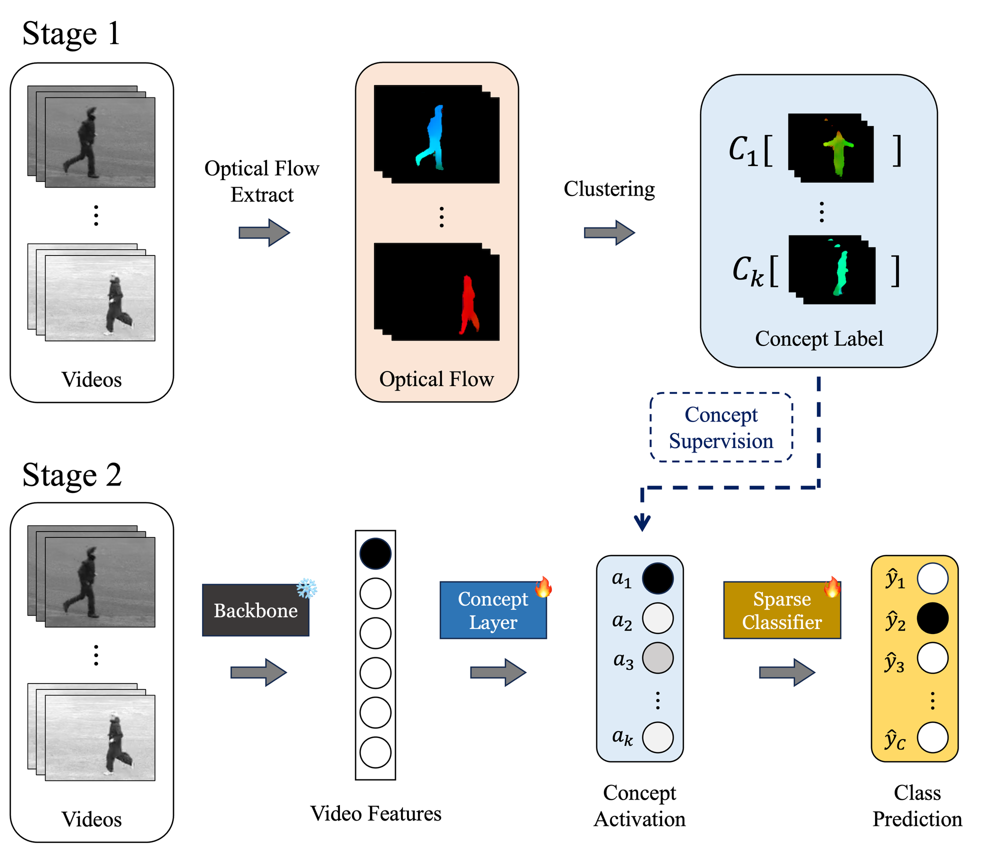
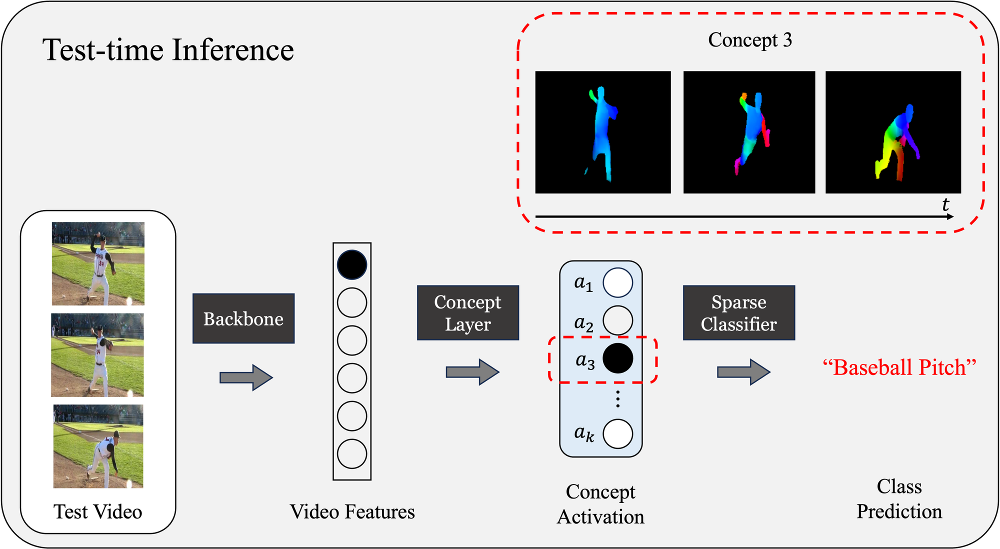

# OF-CBM: Optical Flow-Based Concept Bottleneck Models for Explainable Video Action Recognition
### KCC 2026

[](https://www.dbpia.co.kr/journal/articleDetail?nodeId=NODE12929954) [](https://www.dbpia.co.kr/journal/articleDetail?nodeId=NODE12929954) [](https://vll.khu.ac.kr/) [](LICENSE)

**Junpyo Hong**<sup>1</sup>, Wooil Lee<sup>2</sup>, Jongseo Lee<sup>2</sup>, Taesoo Park<sup>2</sup>, Jinwoo Choi<sup>2*</sup>

<sup>1</sup>Department of Artificial Intelligence, Kyung Hee University &nbsp;·&nbsp; <sup>2</sup>School of Computer Engineering, Kyung Hee University &nbsp;·&nbsp; <sup>*</sup>Corresponding author

> 🏆 **Paper Award — 2026 Korea Computer Congress (KCC)**, Korean Institute of Information Scientists and Engineers (KIISE), July 2026.

---

<p align="center">
  
</p>
<p align="center"><sub>For each test video, OF-CBM shows the <b>top-activated motion concept</b> (its optical-flow exemplar) next to the prediction. ▶️ <a href="https://github.com/intpboy/OF-CBM/releases/download/v1.0/OF-CBM_demo.mp4">Full video (MP4, higher quality)</a></sub></p>

---

## ✨ Highlights

- 🌀 Discovers **motion concepts straight from dense optical flow** — no predefined concept banks, text labels, or skeleton keypoints.
- 🔍 Each concept is a **visual flow exemplar** (cluster medoid), so an explanation shows the *actual motion pattern* the model relied on.
- 🎞️ Two flow representations — **Raw** (full flow) and **Patched** (16×16 grid) — discovered by **FINCH** with automatic partition selection.
- 🧩 **Frozen VideoMAE** backbone → trainable concept layer → **sparse (GLM-SAGA)** classifier: interpretable by construction.
- 📈 Matches the black-box backbone on **KTH** and **Penn Action** while adding concept-level explanations.

---

## 🖼️ Overview

<p align="center">
  
</p>
<p align="center"><sub><b>Figure 1.</b> The OF-CBM pipeline. <b>Stage 1:</b> dense optical flow is extracted per video and clustered (FINCH) into motion concepts, each represented by a flow exemplar. <b>Stage 2:</b> a frozen VideoMAE backbone feeds a trainable concept layer whose activations drive a sparse classifier.</sub></p>

OF-CBM extends the Concept Bottleneck Model (CBM) framework to video action
recognition by using **dense optical flow** as the basis for motion concept
discovery. Instead of relying on predefined concept banks or indirect motion
representations, concepts emerge directly from clustering normalized flow
fields, producing visually intuitive motion exemplars that can be inspected as
short flow clips.

```
  videos ──► (1) dense optical flow extraction ──► per-video .npy flow arrays
                                                            │
                                                            ▼
                               (2) flow-based motion concept discovery
                                   (FINCH clustering + medoid selection)
                                                            │
                                                            ▼
                               (3) frozen VideoMAE backbone feature extraction
                                                            │
                                                            ▼
                               (4) concept projection + sparse classifier
                                   (GLM-SAGA elastic-net)
```

---

## 📊 Results

Top-1 accuracy (%) reported in the paper. OF-CBM matches the non-interpretable
backbone while adding concept-based explanations.

| Method                   | KTH   | Penn Action |
|--------------------------|:-----:|:-----------:|
| VideoMAE (backbone)      | 91.43 | 97.38       |
| OF-CBM (Raw flow)        | 91.77 | 97.00       |
| OF-CBM (Patched flow)    | 91.77 | 97.19       |

---

## 🛠️ Installation

Tested with Python 3.10 + CUDA 11.8.

```bash
conda create -n ofcbm python=3.10 -y
conda activate ofcbm

git clone https://github.com/intpboy/OF-CBM.git && cd OF-CBM
pip install -r requirements.txt
```

Key dependencies: `torch`, `torchvision` (provides RAFT for flow extraction),
`timm`, `decord`, `opencv-python`, `scikit-learn`, `scikit-image`, `pandas`,
`matplotlib`, `tqdm`. The FINCH implementation is bundled in
`concept_discovery/utils/finch.py`.

---

## 📁 Project Structure

```bash
OF-CBM/
│── flow_extraction/        # step 1: dense optical flow (RAFT)
│── concept_discovery/      # step 2: motion concepts from flow (FINCH + medoid)
│   │── motion_discovery/   #   discover_flow_concepts, flow_subsampling, clustering, labeling
│   └── utils/              #   FINCH algorithm + medoid/IO helpers
│── cbm_training/           # steps 3-4: CBM on frozen VideoMAE features
│   │── feature_extraction/ #   precompute VideoMAE features
│   │── models/             #   cbm, concept_layer, modeling_videomae, glm_saga
│   │── video_dataloader/   #   video I/O and transforms
│   └── utils/              #   cbm / data / similarity utilities
│── datasets/               # annotation files only — no videos (KTH, Penn_action)
│── scripts/                # one subdir per benchmark (kth/, penn_action/): steps 01-05
│── visualize_concept_flows.py   # render discovered concepts as flow images / GIFs
│── requirements.txt
└── README.md
```

---

## 📂 Data

This repository ships **annotation files only** — download the raw videos from
the official sources and point the scripts at them:

- [**KTH Action**](https://www.csc.kth.se/cvap/actions/) — 6 action classes, 599 videos
- [**Penn Action**](http://dreamdragon.github.io/PennAction/) — 15 classes, 2,326 videos

Each `datasets/<name>/{train,val}.csv` has rows of `video_filename,label_index`,
and `class_list.txt` maps each label index (by line order) to a class name.

**Backbone checkpoint.** Steps 3–5 require a **VideoMAE ViT-B/16** checkpoint
(Kinetics-400 pretrained, optionally fine-tuned on the target dataset). Produce
or download one with the official [VideoMAE](https://github.com/MCG-NJU/VideoMAE)
repository and pass its path via `FINETUNE_PATH`.

---

## 🚀 Running the pipeline

Every script is plain `bash` and reads its paths from environment variables, so
nothing needs to be edited for a new machine. KTH example:

```bash
# 1. dense optical flow for every video  → flows/kth/*.npy
VIDEO_ROOT=/path/to/KTH/videos bash scripts/kth/01_extract_flow.sh

# 2. flow-based motion concept discovery (FINCH, train-only)
bash scripts/kth/02_discover_concepts.sh         # Raw flow
bash scripts/kth/02_discover_concepts_patch.sh   # Patched flow

# 3. precompute frozen VideoMAE backbone features
VIDEO_ROOT=/path/to/KTH/videos \
FINETUNE_PATH=/path/to/videomae_vit_b_16.pth \
bash scripts/kth/03_extract_backbone_features.sh

# 4. train the concept projection + sparse classifier
bash scripts/kth/04_train_cbm.sh                 # Raw flow
bash scripts/kth/04_train_cbm_patch.sh           # Patched flow

# 5. (optional) non-interpretable backbone baseline
bash scripts/kth/05_baseline.sh
```

The same seven scripts exist under `scripts/penn_action/`. Common overrides:
`FLOW_DIR`, `FEAT_DIR`, `CONCEPT_DIR`, `BACKBONE_FEATS`, `SAVE_DIR` (see the
header of each script for its defaults).

---

## 🌀 Flow representations

Two representations are implemented in
`concept_discovery/motion_discovery/flow_subsampling.py`:

- **Raw** — the full normalized flow tensor is flattened into one
  high-dimensional vector per video. Preserves fine spatial detail; well suited
  to datasets with well-localized motion (e.g. KTH).
- **Patched** — the flow is divided into a `P×P` patch grid (default `P=16`,
  i.e. 14×14 patches at 224×224) and each patch is summarized by its mean
  `(dx, dy)`, cutting the feature dimensionality by roughly `256×`.

Both normalize each sample by its peak magnitude so that flow vectors lie in
`[-1, 1]`, making clustering invariant to absolute motion speed.

> **Optical flow is pluggable.** The paper extracts flow with **WAFT**. This repo
> ships a self-contained **RAFT** extractor (`flow_extraction/extract_raft_flow.py`,
> via torchvision) so the pipeline runs out of the box. Any dense-flow method can
> be substituted — the only contract is that each video becomes one `.npy` array
> of shape `(L-1, H, W, 2)` holding `(dx, dy)` in pixels.

---

## 🔎 Concept discovery

`discover_flow_concepts.py` runs the discovery stage:

1. Load and subsample flow (`FlowDataset`).
2. Cluster train-set features with **FINCH**; with `--use_partition_num -1`
   (default) the partition with the highest NMI against action labels is picked
   automatically.
3. For each cluster, pick the **medoid** (the sample minimizing the sum of
   intra-cluster distances) as its visual representative.
4. Assign validation samples by nearest medoid (`--train_only`) to avoid data
   leakage.
5. Emit per-video concept labels (`hard_label_train.pkl` / `hard_label_val.pkl`)
   plus `sequence_cluster_map.json`, `concept_index.txt`, and
   `video_attributes.json` under a `<N>concepts_<timestamp>_trainonly/` directory.

---

## 🎓 CBM training

`train_of_cbm.py` learns a two-stage CBM on top of frozen VideoMAE features:

1. **Concept projection layer** — trained with a cosine-similarity loss that
   aligns backbone features with the discovered concept vectors.
2. **Sparse linear classifier** — trained with cross-entropy plus elastic-net
   regularization via `glm_saga`, producing a small, interpretable set of
   concept → class weights per action.

`--backbone_features` and `--pose_label` point to the artifacts produced by
steps 3 and 2 respectively. The OF-CBM configuration uses `--train_mode pose`.

---

## 🎬 Interpretability

<p align="center">
  
</p>
<p align="center"><sub><b>Figure 2.</b> Test-time inference. The most-activated motion concept (here, concept 3) is traced back to its optical-flow exemplar, giving a visual explanation for the predicted action.</sub></p>

`visualize_concept_flows.py` renders each discovered concept's medoid as a flow
image (and optionally a GIF), tracing a prediction back to the motion pattern it
relied on:

```bash
python visualize_concept_flows.py \
    --dataset kth \
    --concept_dir concept_discovery/output/kth_raw/raw/raw/<...>_trainonly \
    --flow_path flows/kth \
    --output_path figures/kth_concepts.png \
    --save_frames --save_gifs
```

---

## 📎 Citation

```bibtex
@inproceedings{hong2026ofcbm,
  title     = {{OF-CBM}: Optical Flow-Based Concept Bottleneck Models for Explainable Video Action Recognition},
  author    = {Hong, Junpyo and Lee, Wooil and Lee, Jongseo and Park, Taesoo and Choi, Jinwoo},
  booktitle = {Proceedings of the Korea Computer Congress (KCC)},
  year      = {2026}
}
```

---

## 📜 License

Released under the [MIT License](LICENSE).
